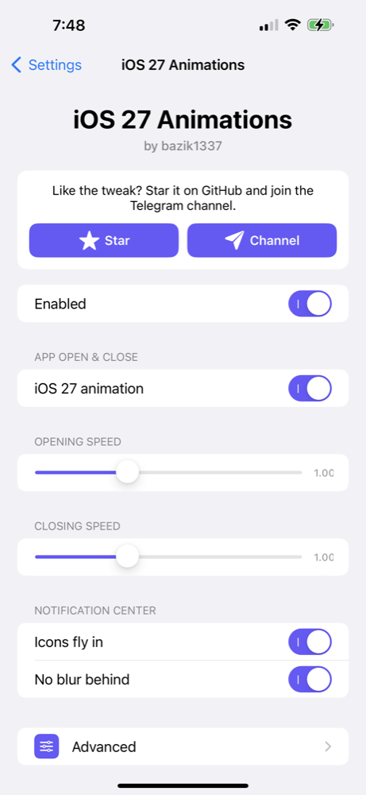
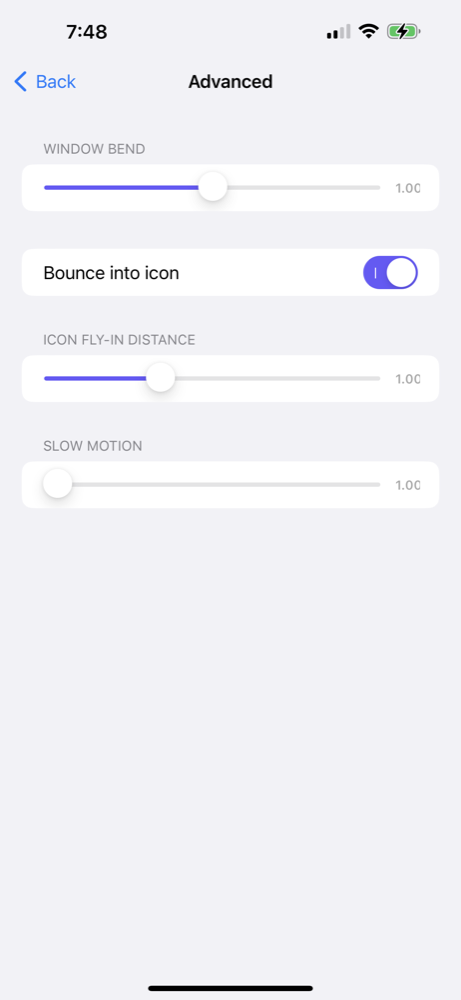

# iOS 27 Animations + Liquid Switch

Анимации iOS 27 для iOS 15–16 (rootless и rootful, arm64/arm64e): открытие и закрытие приложений с эффектом джина, разлёт иконок при закрытии шторки.

<p>

</p>

## Интегрированный Theseus Liquid Switch

- Версия `1.5.7+ningzh1` включает исходники Theseus Switch непосредственно в `iOS2627Anims.dylib`; отдельный `TheseusSwitch.dylib` и отдельный пакет не создаются.
- В главной странице настроек добавлен переключатель «Liquid switch» (по умолчанию выключен). Он управляет заменой системных `UISwitch`; изменения распространяются через существующее Darwin-уведомление.
- Logos-анимации остаются только в SpringBoard; UIKit-фильтр включает ту же библиотеку в приложениях, чтобы там работал переключатель.
- Оригинальные лицензия, уведомление и манифест Theseus сохранены в `iOS27Animations/SwitchFeature/Vendor`.

## Установка

1. Sileo → Источники → «+» → `https://repo.ba31k.com/`
2. Установи **iOS 27 Animations**.
3. Настройки → iOS 27 Animations → **Включено**.

Или скачай `.deb` из [Releases](https://github.com/ba31k/ios26-27-anims/releases).

<p>


</p>

## Сурсы

- `iOS27Animations` 1.5.5
- `iOS27AnimationsReborn` 1.0.0 Beta 2

```sh
make -C iOS27Animations package FINALPACKAGE=1
make -C iOS27AnimationsReborn package FINALPACKAGE=1
```

Для rootful добавь `THEOS_PACKAGE_SCHEME=`.

Обновления — в канале [@ba31k_tweaks](https://t.me/ba31k_tweaks). Автор — [@bazik1337](https://t.me/bazik1337).
