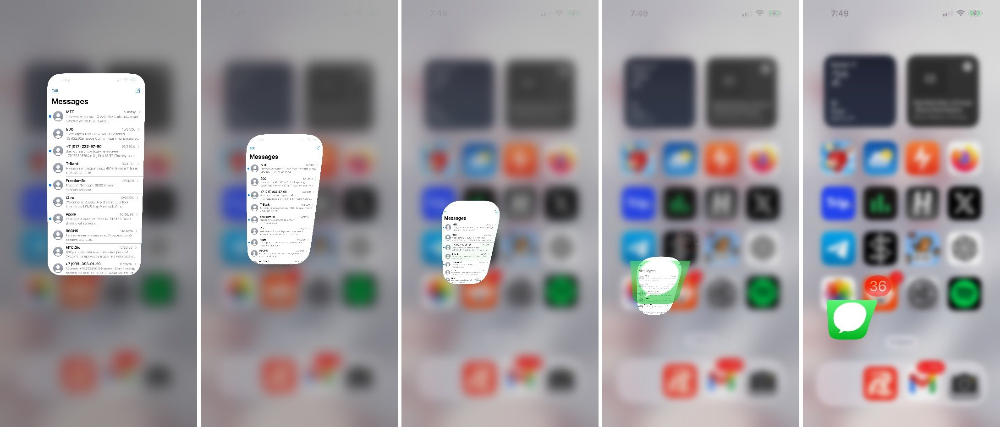

# iOS 27 Animations + Liquid Switch

Анимации iOS 27 для iOS 15–16 (rootless и rootful, arm64/arm64e): открытие и закрытие приложений с эффектом джина, разлёт иконок при закрытии шторки.

<p>

</p>

## Интегрированный Theseus Liquid Switch

- `1.5.9+ningzh1` withdraws the user-confirmed `1.5.8` regression. All non-QQ runtime paths are restored to `1.5.7`; the shared configuration fix is retained.
- Only `com.tencent.mqq` uses a passive visual adapter: native UISwitch handles touches, values and actions; source-owned glass captures its row over an opaque background. No QQ fix is claimed as device-verified.
- `tests/check-qq-switch.py` checks the 1.5.7 scope baseline and executes extracted production ownership/visual control flow on macOS stand-ins. These tests are not a substitute for QQ real-device validation.
- Theseus Switch remains integrated into the single `iOS2627Anims.dylib`; no independent `TheseusSwitch.dylib` or package is produced.
- В главной странице настроек добавлен переключатель «Liquid switch» (по умолчанию выключен). Он управляет заменой системных `UISwitch`; изменения распространяются через существующее Darwin-уведомление.
- Logos-анимации остаются только в SpringBoard; UIKit-фильтр включает ту же библиотеку в приложениях, чтобы там работал переключатель.
- Оригинальные лицензия, уведомление и манифест Theseus сохранены в `iOS27Animations/SwitchFeature/Vendor`.

## Notification Banner Animation

- The reconstructed iOS 15–17 banner motion is compiled into the existing `iOS2627Anims.dylib`; there is no separate banner library, PreferenceBundle or package.
- The Settings home card contains one independent enable switch and one link to the banner detail page. Elasticity, transition duration and dwell duration remain on that detail page.
- Runtime settings use only `com.ning.ios2627anims` and `com.ning.ios2627anims/changed`. No legacy preference domain is read.
- `iOS27Animations/BannerFeature/tests` exercises production motion, reference geometry, compact-line state and clock parsing. These tests are static/native C coverage, not UIKit or device validation.
- The upstream attribution and non-commercial notice are retained in `BannerFeature/NOTICE.md` and `BannerFeature/LICENSE-CC-BY-NC-4.0.txt`.

## Установка

1. Sileo → Источники → «+» → `https://repo.ba31k.com/`
2. Установи **iOS 27 Animations**.
3. Настройки → iOS 27 Animations → **Включено**.

Или скачай `.deb` из [Releases](https://github.com/ba31k/ios26-27-anims/releases).

<p>


</p>

## Сурсы

- `iOS27Animations` 1.5.5
- `iOS27AnimationsReborn` 1.0.0 Beta 2

```sh
make -C iOS27Animations package FINALPACKAGE=1
make -C iOS27AnimationsReborn package FINALPACKAGE=1
```

Для rootful добавь `THEOS_PACKAGE_SCHEME=`.

Обновления — в канале [@ba31k_tweaks](https://t.me/ba31k_tweaks). Автор — [@bazik1337](https://t.me/bazik1337).
